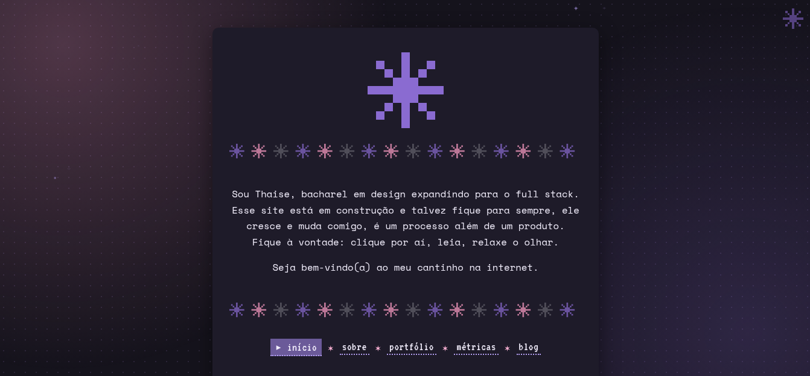
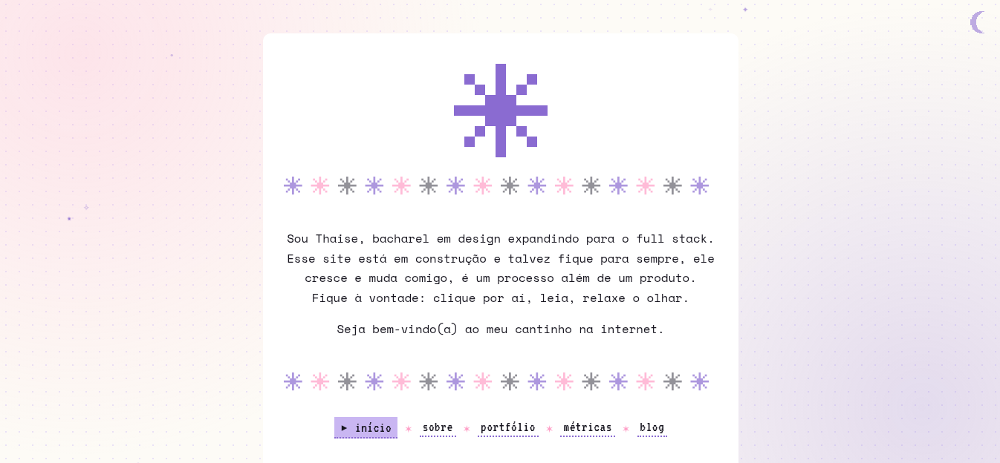

# thaiveira.com.br

Meu site, portfólio e blog que é um playground que cresce e muda comigo. Feito com HTML, CSS, JavaScript, um pouco de Python e café.

🌐 **[thaiveira.com.br](https://thaiveira.com.br)**


  
## O que tem aqui

- **Visual pixel art**: estrelas, lua, separadores, ícones e fontes em pixel art.
- **Tema claro e escuro**: botão no canto superior da tela, com a escolha salva no navegador e mantida entre as páginas.
- **Galeria com lightbox**: `<dialog>` nativo, setas e teclado, swipe no celular e transição suave (View Transitions API).
- **Métricas automáticas**: gráficos de commits e linguagens do meu [GitHub](https://github.com/thaiveira) e [Codeberg](https://codeberg.org/thaiveira), gerados em Python e atualizados todo mês por uma GitHub Action.
- **Sem frameworks**: HTML, CSS e JS puros, sem build.




## Estrutura

```
.
├── .github/workflows/metricas.yml   # Action das métricas
├── imagens/                         # imagens do visual do site
├── js/                              # tema, galeria e efeitos
├── posts/                           # blog, um .html por post (+ imagens/ dos posts)
├── scripts/metricas/                # gerar_metricas.py, fontes e requirements.txt
├── style/style.css
├── *.html                           # index, sobre, portfolio, metricas, blog...
├── feed.xml                         # RSS do blog
└── CNAME                            # domínio personalizado
```

## Métricas

`scripts/metricas/gerar_metricas.py` busca commits dos últimos 6 meses e a distribuição de linguagens aqui no meu GiHub e lá no meu Codeberg. As horas de estudo vêm de `study_log.json`, que atualizo à mão.

**Automático:** o workflow roda todo fim de mês e abre um **pull request** para eu revisar e aceitar.

## Deploy

GitHub Pages, via VScodium.